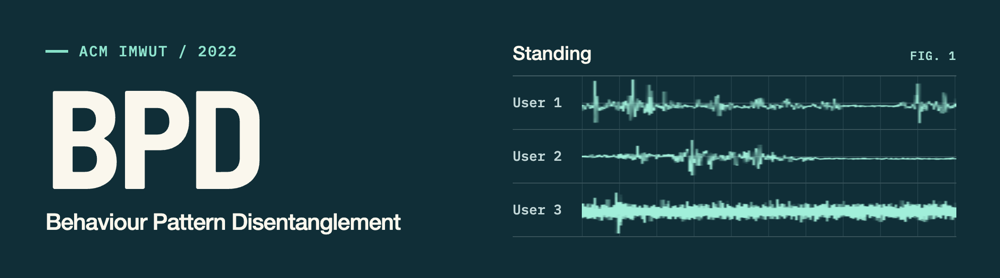
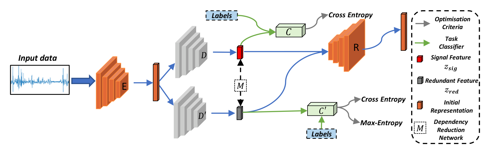
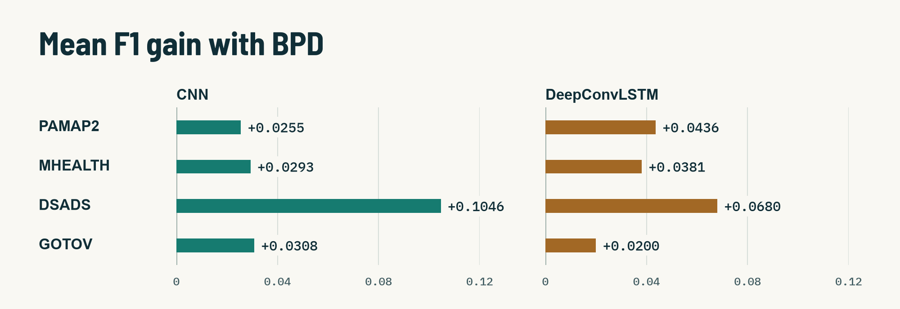

<p align="right"><strong>English</strong> · <a href="README.zh-CN.md" lang="zh-CN">简体中文</a></p>



# Learning Disentangled Behaviour Patterns for Wearable-based Human Activity Recognition

Jie Su · Zhenyu Wen · Tao Lin · Yu Guan<br>
*ACM IMWUT*, Volume 6, Issue 1, Article 28 · March 2022

[ACM paper](https://doi.org/10.1145/3517252) · [arXiv](https://arxiv.org/abs/2202.07260) · [Results](#cross-subject-results) · [Code and data](#code-and-data) · [BibTeX](#citation)

Three people can all be standing still and produce quite different sensor readings, as the traces from Figure 1 show above. What part of the signal tells us that a *new* wearer is standing? Behaviour Pattern Disentanglement (BPD) trains an activity classifier to use the patterns that people share. This repository contains the official PyTorch implementation.

## How BPD works



*Figure 2 from the paper. At inference, a sensor window follows the upper path through the encoder (E), activity disentangler (D) and classifier (C).*

During training, two branches split the features from a CNN or DeepConvLSTM encoder. One learns to predict the activity. In the other branch, an adversarial objective makes activity labels hard to recover, leaving room for variation such as personal movement style. A mutual information objective reduces dependence between the branches, while a reconstructor uses both to recover the encoder features.

## Cross-subject results

Each experiment holds out one participant, trains on the others and repeats for every participant. The chart shows how much adding BPD improves each backbone’s mean F1 across held-out participants. The largest gain is on DSADS for both backbones.



<details>
<summary>View the mean F1 scores from Tables 2–5</summary>

Each cell shows the backbone alone → **with BPD**.

| Dataset | CNN | DeepConvLSTM |
| --- | ---: | ---: |
| PAMAP2 | 0.7640 → **0.7895** | 0.7393 → **0.7829** |
| MHEALTH | 0.9367 → **0.9660** | 0.9195 → **0.9576** |
| DSADS | 0.7136 → **0.8182** | 0.7390 → **0.8070** |
| GOTOV | 0.6645 → **0.6953** | 0.6492 → **0.6692** |

</details>

## Code and data

| File | What to look for |
| --- | --- |
| [bpd_main.py](bpd_main.py) | Training objectives, held-out participant evaluation and macro-F1 scoring |
| [model/build_net.py](model/build_net.py) | Backbone selection (`cnn` or `convlstmv2`) and BPD modules |
| [datasets/dataset_load.py](datasets/dataset_load.py) | Participant filenames, expected MATLAB fields and sliding windows |

Training requires a CUDA-enabled PyTorch environment with NumPy 1.x, SciPy, scikit-learn, TensorBoard and tqdm. Supply the preprocessed per-participant `.mat` files separately. For example, when running from the repository root, the DSADS loader looks for `../data/DSADS_Dataset/Processed/subject_1.mat` through `subject_8.mat`, with sensor readings in `data` and activity labels in `label`.

Run this command from the repository root to see the training arguments.

```bash
python bpd_main.py --help
```

## Citation

```bibtex
@article{su2022bpd,
  author   = {Su, Jie and Wen, Zhenyu and Lin, Tao and Guan, Yu},
  title    = {Learning Disentangled Behaviour Patterns for Wearable-based Human Activity Recognition},
  journal  = {Proceedings of the ACM on Interactive, Mobile, Wearable and Ubiquitous Technologies},
  year     = {2022},
  month    = mar,
  volume   = {6},
  number   = {1},
  articleno = {28},
  numpages = {19},
  doi      = {10.1145/3517252}
}
```

The implementation is available under the [Apache 2.0 license](LICENSE).
