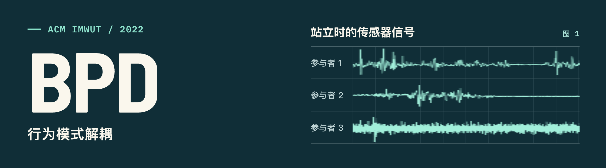
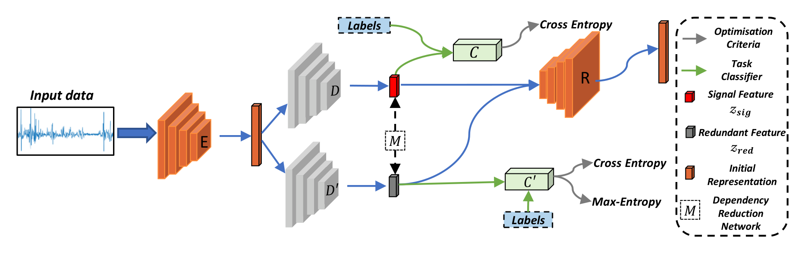
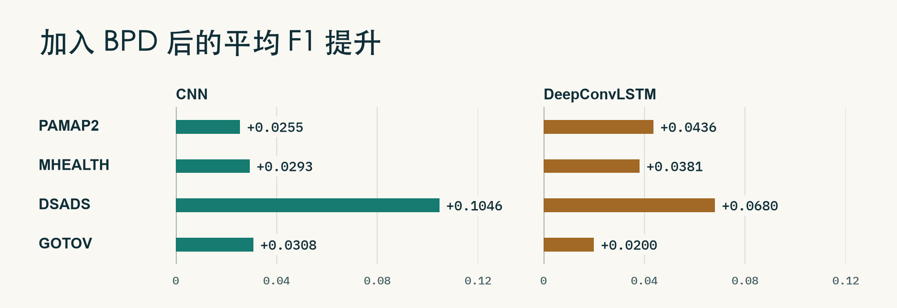

<p align="right"><a href="README.md" lang="en">English</a> · <strong>简体中文</strong></p>



# 面向可穿戴人体活动识别的行为模式解耦学习

Jie Su · Zhenyu Wen · Tao Lin · Yu Guan<br>
*ACM IMWUT*，第 6 卷第 1 期，第 28 篇，2022 年 3 月

[ACM 论文](https://doi.org/10.1145/3517252) · [arXiv 预印本](https://arxiv.org/abs/2202.07260) · [实验结果](#跨受试者识别结果) · [代码与数据](#代码与数据) · [BibTeX 引用](#引用)

## 关于 BPD

封面上的三段波形来自三位站立的佩戴者。同一种活动会产生不同的传感器读数。行为模式解耦（Behaviour Pattern Disentanglement，BPD）将不同人共有的活动特征与个人动作习惯带来的差异分开，帮助分类器识别新佩戴者的活动。本仓库提供论文的官方 PyTorch 实现，支持 CNN 和 DeepConvLSTM 两种骨干网络。

## BPD 如何识别活动



*论文图 2。推理时，一个传感器时间窗沿上方路径依次经过编码器（E）、活动特征解耦器（D）和分类器（C），得到活动类别。*

训练时，CNN 或 DeepConvLSTM 编码器提取的特征进入两个分支。一个分支学习预测活动类别，另一个分支通过对抗训练，让分类器难以从中判断活动类别，从而容纳个人动作习惯等差异。模型通过互信息约束降低两个分支之间的依赖，再用两者共同重建编码器特征。

## 跨受试者识别结果

实验采用留一受试者交叉验证。每轮留出一人测试，用其余人的数据训练，最后对每位受试者的 F1 取平均。下图展示了各骨干网络加入 BPD 后的平均 F1 提升。两个骨干网络的最大提升都出现在 DSADS 上。



<details>
<summary>查看论文表 2–5 中的平均 F1 分数</summary>

每个单元格按「原始骨干网络 → **加入 BPD 后**」排列。

| 数据集 | CNN | DeepConvLSTM |
| --- | ---: | ---: |
| PAMAP2 | 0.7640 → **0.7895** | 0.7393 → **0.7829** |
| MHEALTH | 0.9367 → **0.9660** | 0.9195 → **0.9576** |
| DSADS | 0.7136 → **0.8182** | 0.7390 → **0.8070** |
| GOTOV | 0.6645 → **0.6953** | 0.6492 → **0.6692** |

</details>

## 代码与数据

| 文件 | 内容 |
| --- | --- |
| [bpd_main.py](bpd_main.py) | 训练目标、留出受试者上的评估及宏平均 F1 的计算 |
| [model/build_net.py](model/build_net.py) | 骨干网络选择（`cnn` 或 `convlstmv2`）及 BPD 各模块 |
| [datasets/dataset_load.py](datasets/dataset_load.py) | 各受试者的文件名、所需的 MATLAB 字段及滑窗方式 |

训练需要支持 CUDA 的 PyTorch 环境，以及 NumPy 1.x、SciPy、scikit-learn、TensorBoard 和 tqdm。请单独准备按受试者划分、已完成预处理的 `.mat` 文件。例如，从仓库根目录启动时，DSADS 加载器会读取 `../data/DSADS_Dataset/Processed/subject_1.mat` 至 `subject_8.mat`，其中 `data` 保存传感器读数，`label` 保存活动标签。

在仓库根目录运行以下命令可查看训练参数。

```bash
python bpd_main.py --help
```

## 引用

```bibtex
@article{su2022bpd,
  author   = {Su, Jie and Wen, Zhenyu and Lin, Tao and Guan, Yu},
  title    = {Learning Disentangled Behaviour Patterns for Wearable-based Human Activity Recognition},
  journal  = {Proceedings of the ACM on Interactive, Mobile, Wearable and Ubiquitous Technologies},
  year     = {2022},
  month    = mar,
  volume   = {6},
  number   = {1},
  articleno = {28},
  numpages = {19},
  doi      = {10.1145/3517252}
}
```

本项目代码采用 [Apache 2.0 许可证](LICENSE)。
